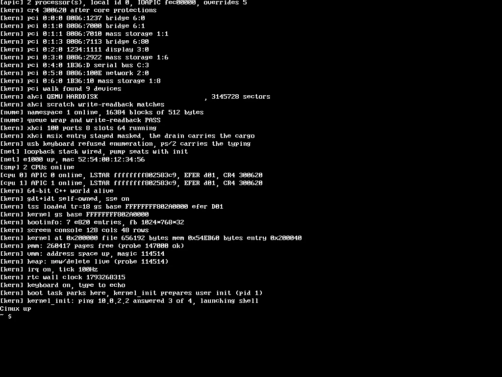
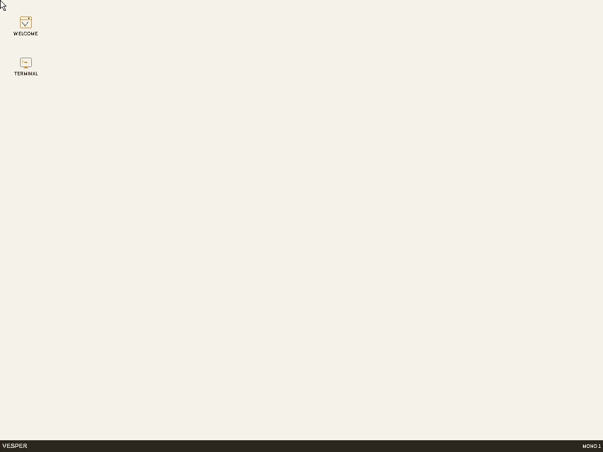
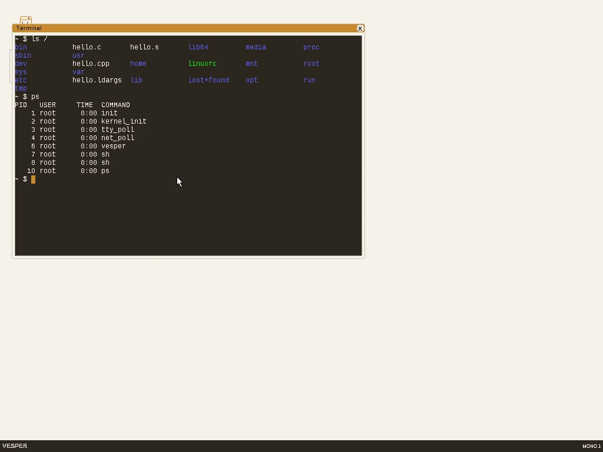
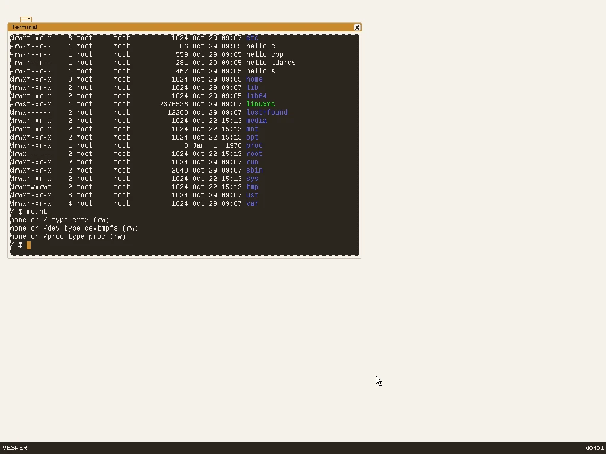
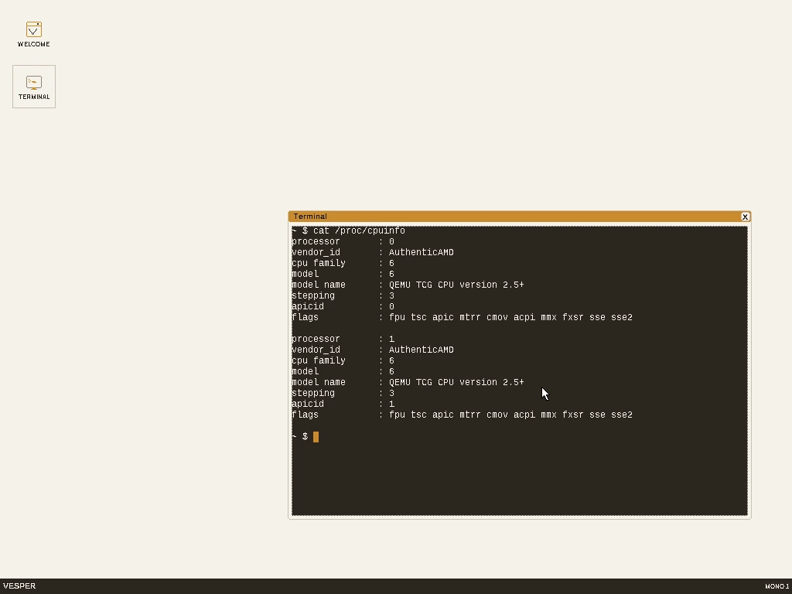
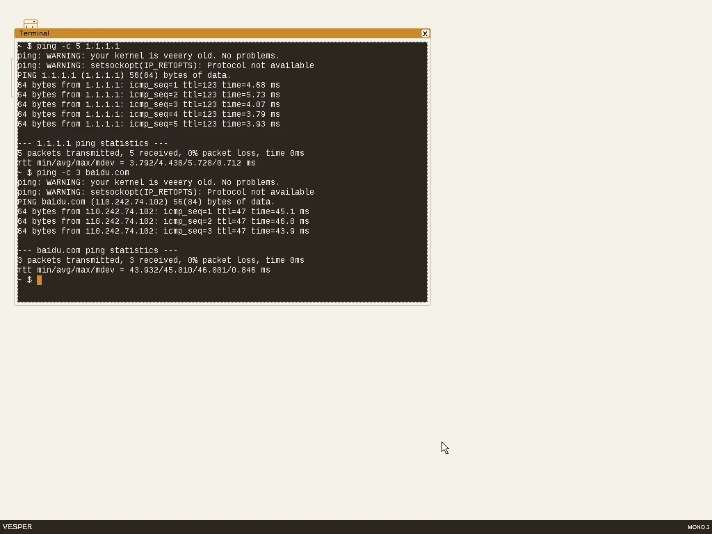
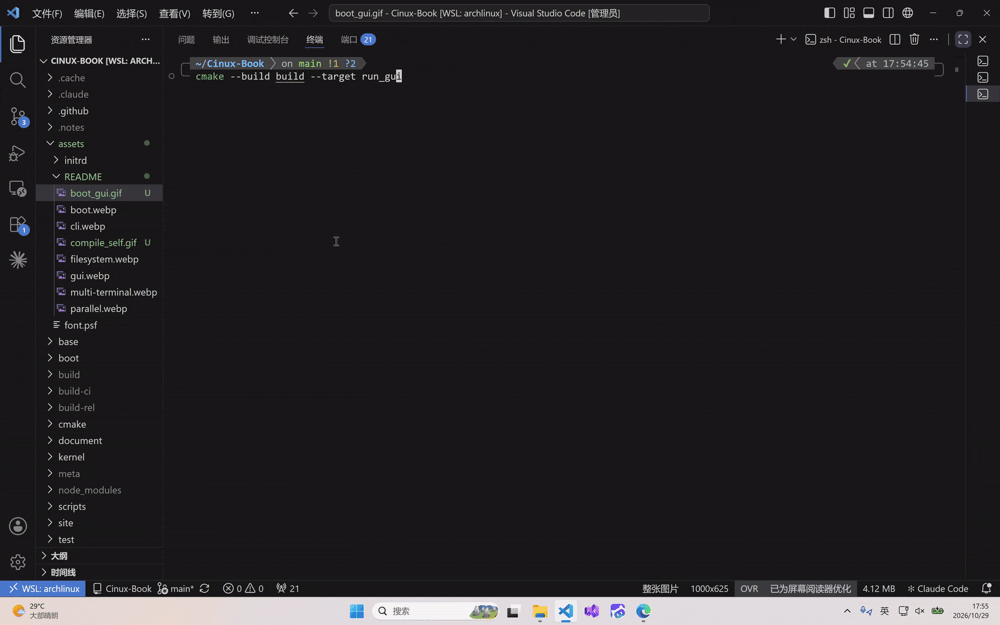
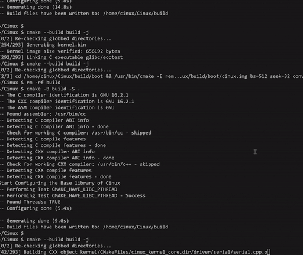

<div align="center">

# Cinux

### 从 512 字节的 MBR 起步，一路长到能把自己重新编译一遍

为什么是Cinux，是因为 C++'s Linux，也是 CharlieChen's \*nix（逃）。

[](LICENSE)
[]()
[]()
[](https://awesome-embedded-learning-studio.github.io/Cinux-Book/)

[在线阅读](https://awesome-embedded-learning-studio.github.io/Cinux-Book/) · [从第一站开始](https://awesome-embedded-learning-studio.github.io/Cinux-Book/journey/01-mbr/)

</div>

---

**Cinux** 是一个从零手搓的 x86_64 操作系统，也是一部边写边讲的中文教程。

从实模式的第一行引导代码开始，保护模式、长模式、物理内存、进程与调度、系统调用、ext2、多核、USB、网卡、TCP/IP、图形桌面，一站一站自己长出来；最后在图形桌面里，用它自己的 GCC 把内核重新编译一遍。

代码和正文同步推进：每一站对应一个可以 checkout 的 tag，正文只讲清楚「为什么是这样」，剩下的交给你在 QEMU 里亲手敲。

> 当前状态：主线打到 `r35_gui_fin`（图形桌面与自编译），正文连载至网络协议栈与网卡驱动。

## 一眼看看

<table>
<tr>
<td align="center" width="33%"><br><sub>开机：VESA 1024×768、PCI 枚举、AHCI / NVMe / xHCI 就位</sub></td>
<td align="center" width="33%"><br><sub>Vesper 桌面：帧缓冲、窗口、图标与输入</sub></td>
<td align="center" width="33%"><br><sub><code>ls /</code> 与 <code>ps</code>：文件树和真实进程表</sub></td>
</tr>
<tr>
<td align="center"><br><sub>ext2 目录、属主、权限，<code>mount</code> 看挂载</sub></td>
<td align="center"><br><sub><code>/proc/cpuinfo</code>：两颗核都活着</sub></td>
<td align="center"><br><sub><code>ping 1.1.1.1</code>：走 QEMU 用户态网络，真外网</sub></td>
</tr>
</table>

## 三十秒跑起来

```bash
git clone --recursive https://github.com/Awesome-Embedded-Learning-Studio/Cinux-Book.git
cd Cinux-Book
cmake -B build -S .
cmake --build build --target run_gui -j
```

QEMU 窗口里亮起来的就是 Cinux：开机日志滚完，直接进 Vesper 桌面。第一次构建会联网下载固定版本的 Buildroot，烤一张 1.5 GiB 的开发盘，视网速可能要等一会儿；之后全部走本地缓存复用。

只想看命令行就把 `run_gui` 换成 `run`，要带调试符号的内核用 `run_debug`。

<p align="center">
  
</p>

## 进去以后能干什么

- 开个终端，`ping baidu.com`，回包是真的从外网绕回来的；
- `ps` 看进程表，`ls /` 看 ext2 目录，`mount` 看挂载关系；
- `~/Cinux` 放着整份源码，`cmake --build build -j` 就在系统里重新编译内核：

<p align="center">
  
</p>

## 装备你的机器

最小配置是 GCC ≥ 14 加 CMake ≥ 3.16，够跑宿主测试：

```bash
cmake --build build --target test_host -j$(nproc)
```

要跑完整系统（QEMU 引导加 Buildroot 开发盘），按发行版装一套。

Ubuntu / Debian：

```bash
sudo apt-get install -y gcc-14 g++-14 gcc-14-multilib g++-14-multilib \
  ccache cmake ninja-build make binutils libc6-dev python3 curl bzip2 xz-utils \
  wget perl patch \
  qemu-system-x86 e2fsprogs file bc bison flex rsync cpio unzip \
  libncurses-dev libssl-dev libarchive-dev pkg-config
```

Arch：

```bash
sudo pacman -S --needed base-devel wget unzip bc \
  cmake ninja qemu-system-x86 qemu-ui-gtk e2fsprogs file bison flex \
  rsync cpio ncurses libarchive openssl pkgconf
```

## 许可证

[MIT](LICENSE)
